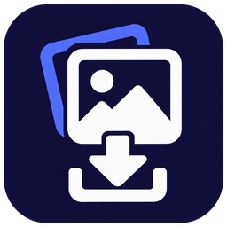
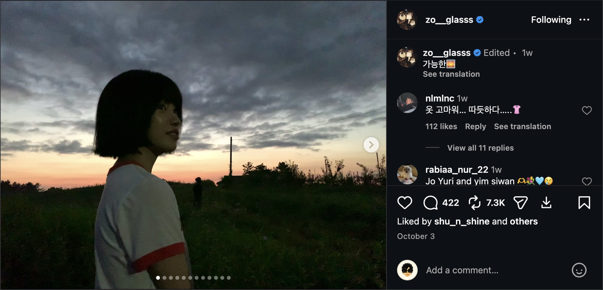
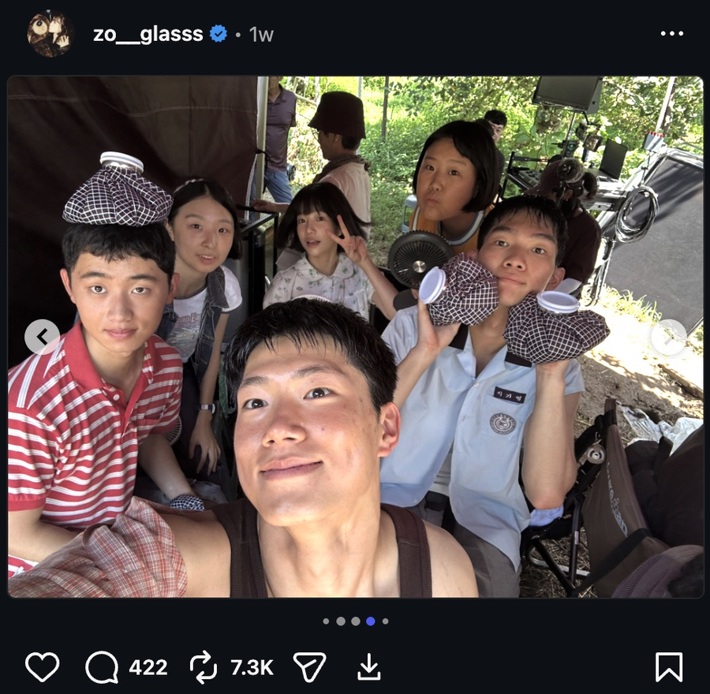
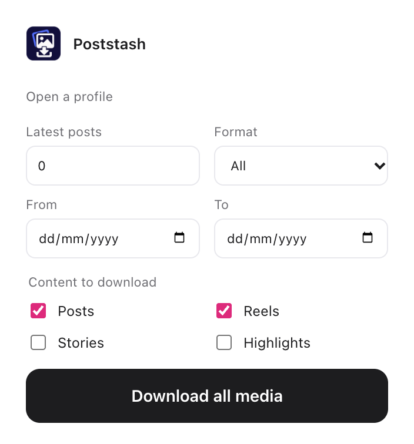
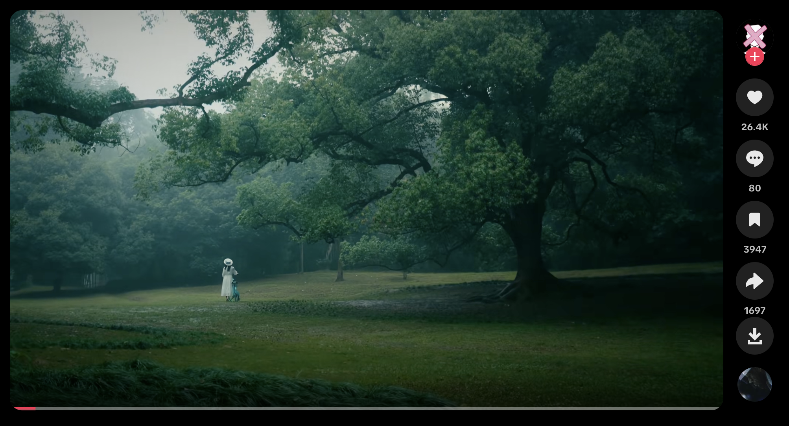
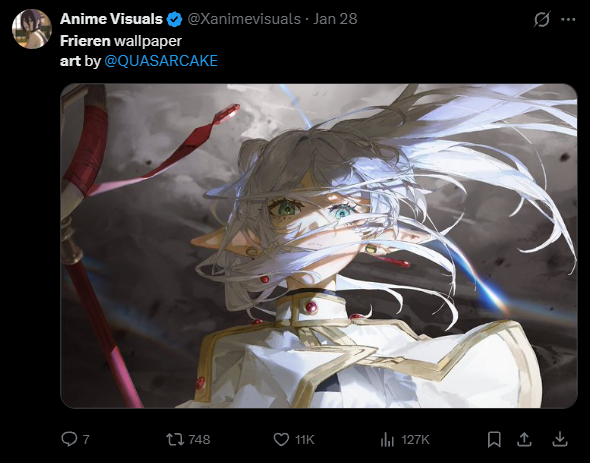
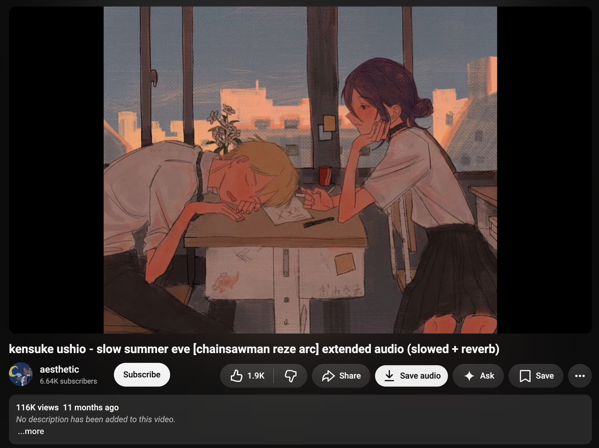

  

<h1 align="center">Poststash</h1>

A multi-platform media downloader for Instagram, TikTok, X, and YouTube.

  <a href="https://github.com/lurantys/poststash/archive/refs/heads/main.zip"><strong>Download ZIP</strong></a>
  &nbsp;·&nbsp;
  <a href="#install">Install</a>
  &nbsp;·&nbsp;
  <a href="https://github.com/lurantys/poststash/issues">Report a bug</a>

  
  

  
   The download icon sits beside Share, in Instagram's own action row.

| Instagram | TikTok | X | YouTube | Your filters |
| --- | --- | --- | --- | --- |
| Posts, carousels, Reels, Stories, Highlights, and profile downloads. | The current video or photo slideshow in the feed or fullscreen viewer. | Photos and videos from an individual post. | Audio from individual videos and Shorts, saved with the video title. | Content types, format, dates, and post limits for Instagram profiles. |

## Install

1. **[Download the ZIP](https://github.com/lurantys/poststash/archive/refs/heads/main.zip)** and unzip it.
2. Open **`chrome://extensions`** in Chrome and turn on **Developer mode**.
3. Click **Load unpacked** and select the **`poststash-main`** folder.
4. Refresh your Instagram, TikTok, X, and YouTube tabs. Pin Poststash to the toolbar for easy access.

**Chrome 116+ · No build step · Uses your browser session**

## Use it

### Instagram

**One post or Reel:** click the download icon beside Share. For carousels, it saves every photo and video.

**A Story or Highlight:** click the download icon in the current Story frame.

**An entire Instagram profile:** open the profile and click **Download all media** beside its name. Open the extension popup to choose filters; **Latest posts = `0`** means all posts.

<table>
  <tr>
    <td align="center"><strong>In the Instagram feed</strong></td>
    <td align="center"><strong>Choose what to save</strong></td>
  </tr>
  <tr>
    <td align="center"></td>
    <td align="center"></td>
  </tr>
</table>

### TikTok

Open `tiktok.com` and click the **download icon** for the video on screen:

- **Main feed:** below Share in the interaction column.
- **Fullscreen viewer:** beside Favorite in the interaction row.

  
   Download from the TikTok feed using the native action column.

TikTok support covers **individual videos and photo slideshows** (each photo saved separately). Profile downloads are not supported yet.

### X

Open `x.com` and click the **download icon** in the action row of a post with photos or video. Poststash saves each media item from that post separately. X support is limited to individual posts; profiles and batches are not supported.

The button is also available beside Share in the media viewer. It shows a spinner while saving and a checkmark after a successful download.

  
   Save media from an X post using the download icon beside Share.

### YouTube

Open a video and click **Save audio** beside Share, below the video. On Shorts, click **Audio** in the current Short's action column.

- Audio saves as **M4A** when available, with **WebM** as a fallback.
- The filename uses the **video title**, preserving spaces and Unicode. Characters that filenames cannot contain are replaced, and very long titles are shortened.
- Downloads work while the video is **paused**. The button shows **Saving…** while the file is prepared.
- Status messages fade in and out and disappear within **two seconds**.

  
   Save a video's audio directly from YouTube's action row.

Live broadcasts are not supported. If YouTube refuses access or a download fails, the button shows an error and lets you retry.

### Download locations

Files are saved inside your browser's download folder:

- Instagram: **`Instagram/<username>/<content type>/`**
- TikTok videos: **`TikTok/<username>/videos/`**
- TikTok photos: **`TikTok/<username>/photos/`**
- X: **`X/`**
- YouTube audio: **`YouTube/<channel>/audio/`**

<strong>Something not working?</strong>

- **Missing button:** reload Poststash in `chrome://extensions`, then refresh Instagram, TikTok, X, or YouTube.
- **Failed download:** check that the media opens while you're signed in, then retry.
- **Still stuck:** [open an issue](https://github.com/lurantys/poststash/issues) with the page type and a screenshot.

