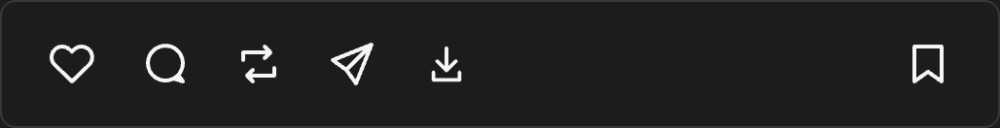

# Poststash

A Chrome extension for saving Instagram photos, videos, carousels, Reels, Stories, and Highlights.

## Install

1. [Download the ZIP](https://github.com/lurantys/poststash/archive/refs/heads/main.zip) and unzip it.
2. Open `chrome://extensions` in Chrome.
3. Turn on **Developer mode**, click **Load unpacked**, and select the unzipped `poststash-main` folder.
4. Refresh any Instagram tabs you already have open.

Requires Chrome 116 or newer. No build step needed.

## Download a post

Open a post or Reel and click the **download icon beside Share**. A carousel downloads all its photos and videos.

For a Story or Highlight, use the download icon in the current Story frame.

## Download a profile

Open an Instagram profile, then click **Download all media** beside the profile name.

To choose content types, photos or videos, a date range, or a post limit, open the **Poststash extension popup**. Set **Latest posts** to `0` for all posts.

Files go into `Instagram/<username>/<content type>/` inside your browser's download folder.

## If something doesn't work

- **Button missing?** Reload Poststash in `chrome://extensions`, then refresh Instagram.
- **Download fails?** Make sure the media opens in Instagram while you're signed in, then try again.
- **Found a bug?** [Open an issue](https://github.com/lurantys/poststash/issues) with the page type, what happened, and a screenshot.
